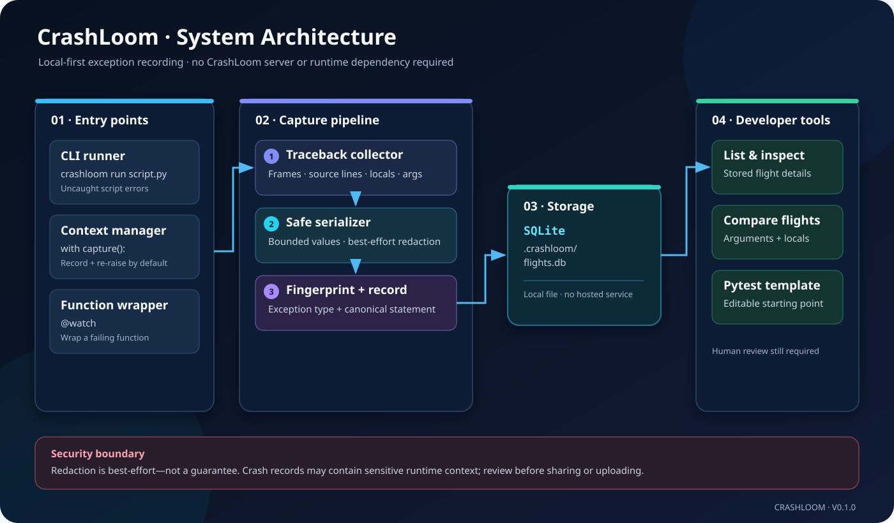
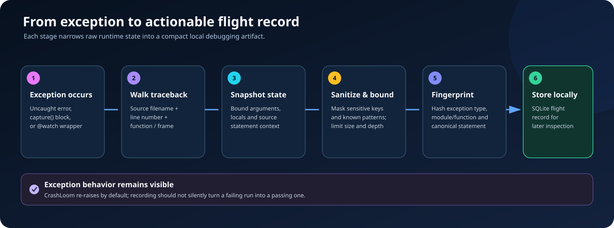
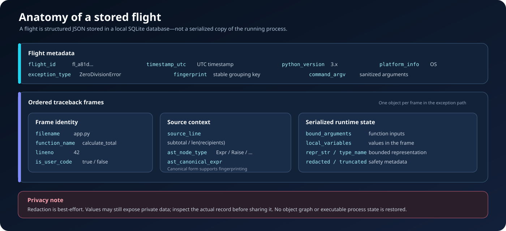
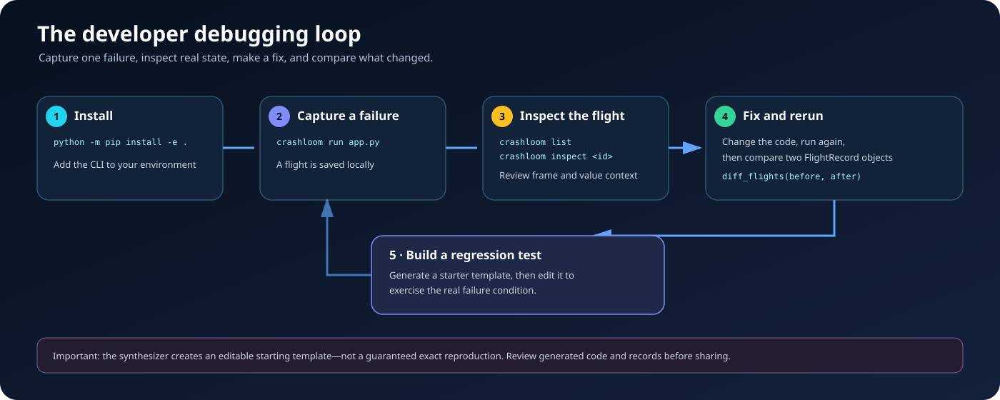

# CrashLoom

**A local-first Python exception flight recorder with deterministic crash fingerprints, bounded runtime-state snapshots, best-effort secret redaction, flight comparison, and editable pytest reproducer templates.**

  

CrashLoom helps Python developers preserve useful context from a failure, inspect it after the exception, and compare two recorded failures while debugging. Records live in a local SQLite database. No CrashLoom server or external telemetry service is required.

## Visual guide

The diagrams below explain the system from four angles: **architecture**, **what happens during a crash**, **what a saved record contains**, and **how a developer uses the tool**. Each diagram is a scalable SVG stored in this repository, so it stays crisp when zoomed.

### 1. System architecture

The CLI runner, \`capture()\` context manager, and \`@watch\` decorator feed the same general collection pipeline. CrashLoom gathers traceback frames, serializes selected values with size limits and best-effort redaction, calculates a fingerprint, then saves a structured flight to \`.crashloom/flights.db\`. The stored record can later be listed, inspected, compared in Python, or used to start a pytest reproducer template.

### 2. What happens when Python crashes

The collector walks the traceback and records frame metadata such as source filename, line number, function name, arguments, and local variables. The serializer limits how much data it keeps and redacts sensitive variable names and several recognizable credential formats. A deterministic fingerprint helps group failures with similar exception and source-statement characteristics. The record is then persisted locally. Exceptions are re-raised by default.

### 3. What is inside a flight record?

A flight is a structured record—not a snapshot of the entire Python process. It includes exception metadata, a fingerprint, environment context, and ordered frame snapshots. Each frame can include source context plus bounded representations of arguments and local variables. Some runtime objects cannot be reconstructed from their representation; fields indicate whether a value was redacted or truncated.

### 4. Developer debugging workflow

Start by recording a reproducible failure, inspect the flight to understand the context, fix the source, and record the next run. Use the \`diff_flights()\` API to compare two stored records. The test synthesizer can generate a useful starting template, but it does **not** guarantee an exact reproduction: review and adapt the generated test to exercise the real failure condition.

## Features

- **Exception flight records:** capture exception type, traceback frames, source snippets, and serialized variable metadata.
- **Bounded serialization:** limit nested depth, collection item count, and rendered string length.
- **Best-effort secret redaction:** redact values held under sensitive variable names and selected common token patterns before storing the captured record.
- **Deterministic fingerprints:** produce a short fingerprint from exception type and canonical source-statement information to help find similar failures.
- **Local SQLite storage:** inspect recorded failures without a hosted backend.
- **Flight comparison API:** compare exception types, source locations, argument values, and locals across two records.
- **Pytest reproducer templates:** generate an editable test starting point from a stored flight.
- **No runtime dependencies:** uses the Python standard library at runtime.

## Install

Requires Python 3.10 or newer.

\`\`\`bash
git clone https://github.com/muhammadsaeed-ai/crashloom.git
cd crashloom
python -m pip install -e .
\`\`\`

For development and tests:

\`\`\`bash
python -m pip install -e ".[dev]"
pytest
\`\`\`

## Quick start

Run a Python script under CrashLoom. When an uncaught exception occurs, CrashLoom records it under \`.crashloom/flights.db\` in the current working directory, then the exception remains visible.

\`\`\`bash
crashloom run examples/demo_payment_crash.py
\`\`\`

List recent flights:

\`\`\`bash
crashloom list --limit 20
\`\`\`

Inspect a flight by its flight ID or fingerprint:

\`\`\`bash
crashloom inspect fl_0123456789ab
\`\`\`

Generate a pytest reproducer template:

\`\`\`bash
crashloom synthesize fl_0123456789ab -o tests/test_reproducer.py
pytest tests/test_reproducer.py
\`\`\`

Replace the sample ID with one returned by \`crashloom list\`.

## Use CrashLoom in Python

Use the context manager when you want to capture an operation inside an application:

\`\`\`python
from crashloom import capture

with capture():
    process_invoice()
\`\`\`

Or decorate a function:

\`\`\`python
from crashloom import watch

@watch
def process_job(job_id: str) -> None:
    run_job(job_id)
\`\`\`

Both interfaces record an exception and re-raise it by default. Set \`reraise=False\` only when suppressing the exception is intentional.

## Compare two flights

The comparison API returns a structured report with fingerprint equality, exception changes, frame locations, argument deltas, and local-variable deltas.

\`\`\`python
from crashloom import FlightStorage, diff_flights

storage = FlightStorage()
before = storage.get("fl_before_id")
after = storage.get("fl_after_id")

if before is not None and after is not None:
    report = diff_flights(before, after)
    print(report.to_json())
\`\`\`

Replace both example identifiers with flight IDs from your local database. Comparison is a report for developer interpretation; it does not automatically identify the root cause.

## CLI reference

| Command | Purpose |
| --- | --- |
| \`crashloom run SCRIPT [ARGS...]\` | Run a script and record uncaught exceptions |
| \`crashloom list [--limit N]\` | List recent stored flights |
| \`crashloom inspect IDENTIFIER\` | Print one flight record as JSON |
| \`crashloom synthesize IDENTIFIER [-o PATH]\` | Write a pytest reproducer starting template |

## Storage and privacy

CrashLoom stores records in \`.crashloom/flights.db\` relative to the current working directory by default. Captured data may include source paths, source lines, exception messages, variable names, and serialized values.

**Redaction is best-effort, not a guarantee.** Arbitrary secrets can evade pattern detection, and exception messages or source lines can themselves contain private information. Inspect flight records and generated artifacts before sharing, publishing, or attaching them to CI logs. Treat the \`.crashloom/\` directory as sensitive debugging data.

## Current limitations

- The redactor targets sensitive variable names and a curated set of common credential patterns; it cannot identify every secret.
- Custom objects are represented safely where possible but are not reconstructed as live objects.
- A generated pytest file is an editable starting point, not an automatically verified reproduction of the original bug.
- CrashLoom is early-stage software. Test it on non-production workloads before relying on it in critical applications.

## Contributing and security

Bug reports and pull requests are welcome. Read [CONTRIBUTING.md](CONTRIBUTING.md) before submitting changes. For sensitive vulnerability reports, see [SECURITY.md](SECURITY.md).

## License

MIT. See [LICENSE](LICENSE).

## Topics

\`python\` · \`debugging\` · \`exception-handling\` · \`traceback\` · \`crash-reporting\` · \`post-mortem-debugging\` · \`flight-recorder\` · \`pytest\` · \`test-generation\` · \`developer-tools\` · \`sqlite\` · \`secret-redaction\` · \`observability\` · \`debugger\` · \`static-analysis\`
