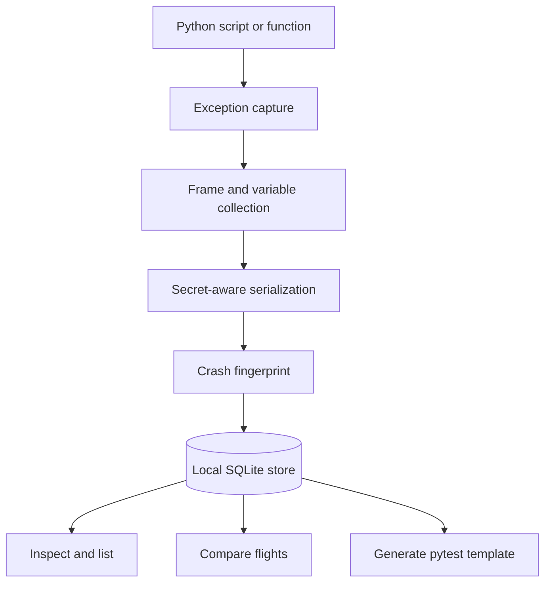

# CrashLoom

**A local-first Python exception flight recorder with deterministic crash fingerprints, secret-aware state capture, flight comparison, and pytest reproducer templates.**

[](https://www.python.org/)
[](LICENSE)
[](pyproject.toml)
[](https://github.com/muhammadsaeed-ai/crashloom/actions/workflows/ci.yml)

CrashLoom records useful debugging context when Python code fails, while keeping the default workflow local and dependency-light. Records are stored in a local SQLite database; no CrashLoom server or external telemetry service is required.

## Features

- **Exception flight records:** capture exception type, traceback frames, source snippets, and serialized variable metadata.
- **Secret-aware serialization:** redact variables with sensitive names and selected token patterns before storing captured state. Redaction is best-effort, not a guarantee; review records before sharing them.
- **Deterministic fingerprints:** group similar failures using exception and source-statement information.
- **Local SQLite storage:** list and inspect captured flights without an external service.
- **Flight comparison:** compare fingerprints, exception types, locations, arguments, and locals between two records.
- **Pytest reproducer templates:** generate a starting test file from a stored flight for developers to refine.
- **No runtime dependencies:** built on the Python standard library.

## Install

Requires Python 3.10 or newer.

```bash
git clone https://github.com/muhammadsaeed-ai/crashloom.git
cd crashloom
python -m pip install -e .
```

For development and tests:

```bash
python -m pip install -e ".[dev]"
pytest
```

## Quick start

Run a script under CrashLoom. An uncaught exception is recorded in `.crashloom/flights.db` in the current working directory and then the exception is re-raised normally.

```bash
crashloom run examples/demo_payment_crash.py
```

List captured crashes:

```bash
crashloom list --limit 20
```

Inspect a flight using its flight ID or fingerprint:

```bash
crashloom inspect fl_0123456789ab
```

Generate a pytest reproducer template:

```bash
crashloom synthesize fl_0123456789ab -o tests/test_reproducer.py
pytest tests/test_reproducer.py
```

The synthesizer currently emits a **starting template**, not a guaranteed exact reproduction of the original bug. Review and adapt it before relying on it.

You can also capture exceptions in application code:

```python
from crashloom import capture

with capture():
    process_invoice()
```

Or decorate a function:

```python
from crashloom import watch

@watch
def process_job(job_id: str) -> None:
    run_job(job_id)
```

`capture()` and `watch()` re-raise exceptions by default. Set `reraise=False` only when suppressing the exception is intentional.

## How it works



## CLI commands

| Command | Purpose |
| --- | --- |
| `crashloom run SCRIPT [ARGS...]` | Execute a script and record uncaught exceptions |
| `crashloom list [--limit N]` | List recent stored flights |
| `crashloom inspect IDENTIFIER` | Print a flight record as JSON |
| `crashloom synthesize IDENTIFIER [-o PATH]` | Write a pytest reproducer template |

## Security and privacy

CrashLoom is designed for local debugging, but **automated redaction cannot guarantee that every secret is removed**. Do not publish flight records, CI logs, or crash databases without reviewing them. Captured tracebacks may contain source paths, source lines, exception messages, and variable names. Store the `.crashloom/` directory securely and add it to backup or artifact exclusions where appropriate.

## Project status

CrashLoom is an early-stage project. Review its behavior and test it in a non-production environment before adding it to critical workloads. The flight comparison API is intentionally structured for extension; reproducer generation is a template generator at this stage.

## Contributing

Bug reports and pull requests are welcome. See [CONTRIBUTING.md](CONTRIBUTING.md) and [SECURITY.md](SECURITY.md).

## License

MIT. See [LICENSE](LICENSE).

## Topics

`python` `debugging` `exception-handling` `traceback` `crash-reporting` `post-mortem-debugging` `flight-recorder` `pytest` `test-generation` `developer-tools` `sqlite` `secret-redaction` `observability` `debugger` `static-analysis`
